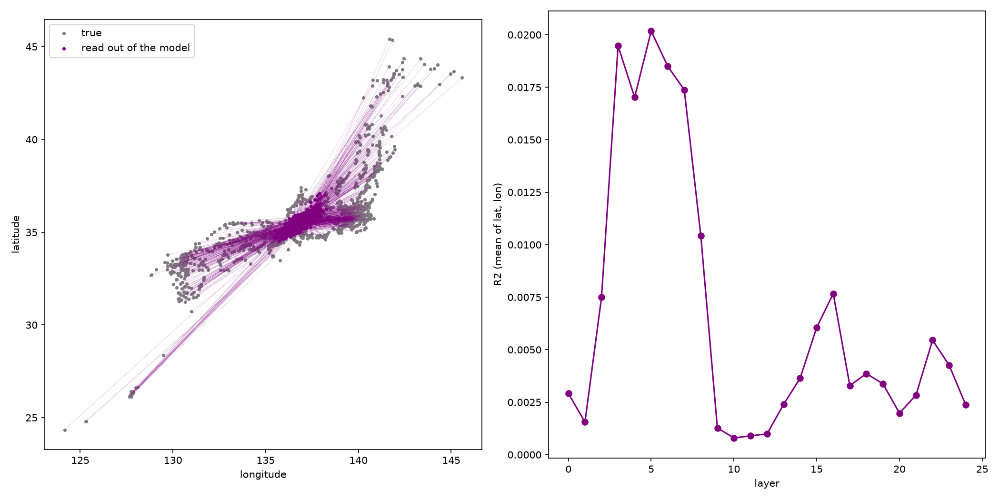
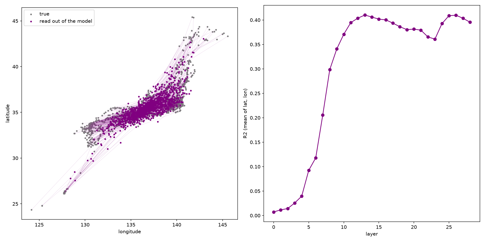
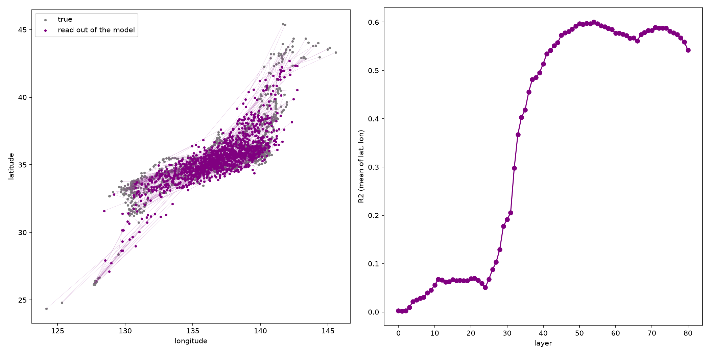
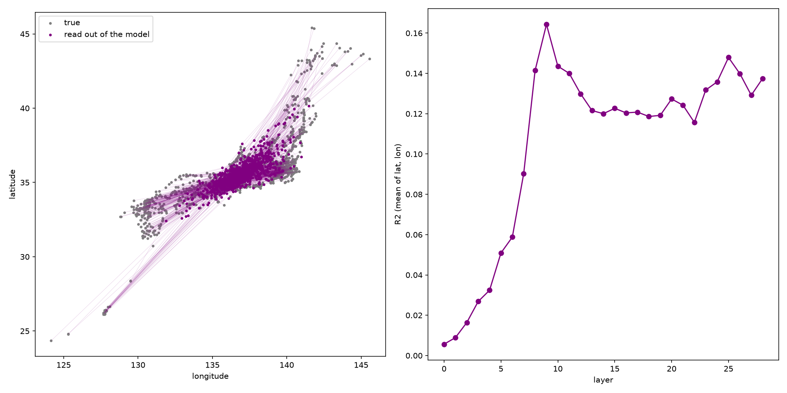
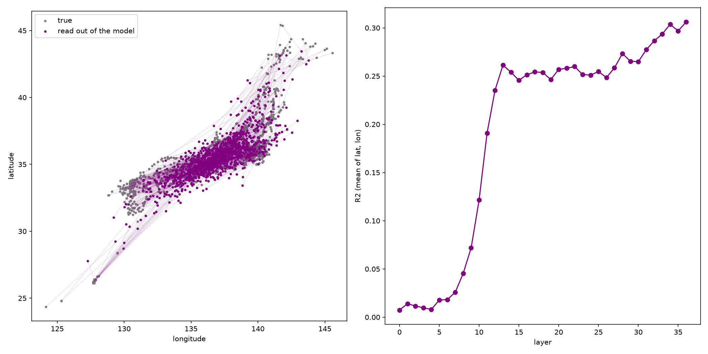
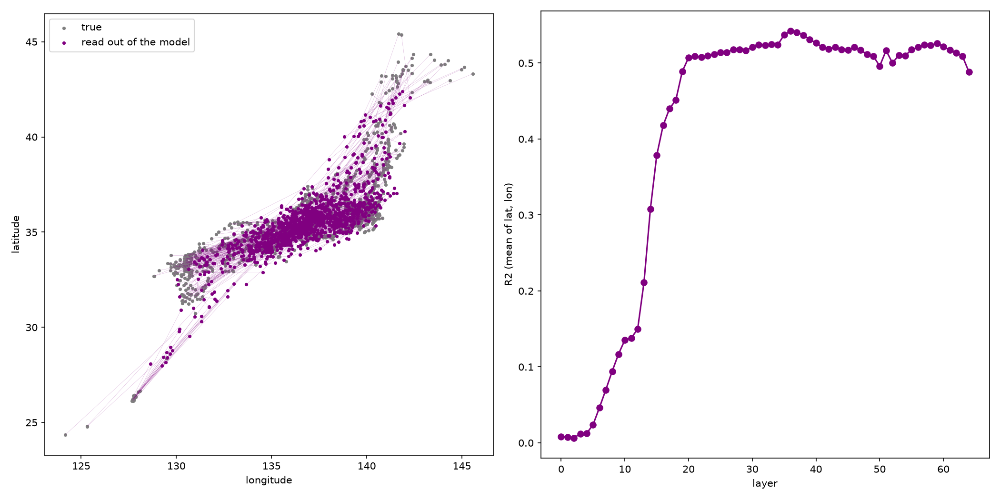
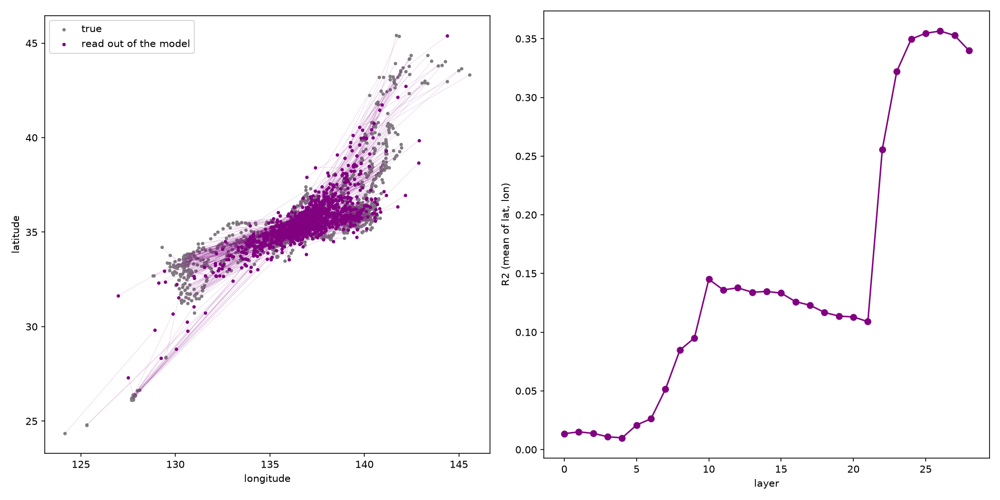

# 第4回 実験レポート：文字しか読んでいないAIの頭の中に、日本地図はあるのか（2026-10-25）

> 動画で省いた細かい数字と手順を置いています。学校のレポートや自由研究への引用・改造は自由です（出典として動画かこのページを書いてください）。数字はすべて `results_colab/` の json・csv から写しています。

## 1. 問いと今日の式
- 問い：都市の名前だけを読んだAIの内部の数字から、その都市の緯度・経度を当てられるか。AIを大きくすると、取り出せる地図は正確になるか。
- 今日の式：緯度 ≒ w·x + b（経度も同じ形）。x＝ある層の、都市名の最後のトークンの内部ベクトル。w と b はリッジ回帰（足し算と掛け算だけの直線の式）で決める。

## 2. 使ったもの
| 項目 | 内容 |
|---|---|
| モデル | Qwen/Qwen2.5-0.5B・1.5B・3B・7B・14B・32B・72B（すべて base。Instruct ではない） |
| 精度 | 0.5B〜14B は bf16、32B・72B は 4bit（bitsandbytes nf4） |
| GPU | Google Colab A100 80GB（試走は CPU で 0.5B・1.5B） |
| ライブラリ | transformers・scikit-learn（Ridge、KFold、GroupKFold）・pandas。版は記録していない |
| 実行日 | 2026-10-25 |
| コード | `japan_map.py`、ノート `04_japan_map.ipynb` |

## 3. データ
- GeoNames `cities15000`（人口1.5万人以上の都市、CC BY 4.0）のうち日本の **1,247都市**（英語名で重複を除く）。人口の多い順に並べた上位50都市を「大きい50都市」と呼んでいる。
- 入力は `"Place: " + 都市名`（漢字版は `"地名：" + 都市名`）。先頭に前置きを付けたのは、文の最初の位置は数字が極端になりやすいため。
- 漢字の都市名は GeoNames の別名データ（言語コード ja）から取った（cities15000 の別名欄は中国語の簡体字が混ざるので使わない）。

## 4. 手順
1. 都市名を1つずつ入れ、全部の層の「最後のトークン」のベクトルを保存。
2. 層ごとに、標準化 → リッジ回帰で緯度・経度を当てる。**5分割交差検証**（4つで式を作り、答えを見ていない残り1つで当てる）。強さ α は 1〜100,000 から層ごとに一番よいもの。
3. R²（緯度と経度の平均）が一番高い層で、ずれを大円距離（地球の半径 6,371km）で測る。
4. 見張り（くらべる相手）：①全部「日本のまん中」と答える ②答えをシャッフルして同じことをする ③都道府県ごと隠して当てる（GroupKFold、きびしい版）。

## 5. 結果
### 大きさ別（英語名・1,247都市）
| モデル | 層の数 | 一番よい層 | R² 緯度/経度 | 大きい50都市のずれ（中央値） | 全都市のずれ（中央値） | 県ごと隠す版 | 100km以内の割合 |
|---|---|---|---|---|---|---|---|
| 0.5B | 24 | 5 | 0.03/0.02 | 245km | 277km | – | – |
| 1.5B | 28 | 9 | 0.18/0.15 | 158km | 260km | – | – |
| 3B | 36 | 36 | 0.33/0.28 | 140km | 230km | – | – |
| 7B | 28 | 13 | 0.44/0.38 | 109km | 214km | – | – |
| 14B | 48 | 42 | 0.59/0.50 | 94km | 180km | – | – |
| 32B（4bit） | 64 | 36 | 0.58/0.50 | 94km | 175km | – | – |
| 72B（4bit） | 80 | 54 | 0.635/0.566 | **80km** | 160.9km | 185.2km | 28.6% |

くらべる相手（72B）：全部まん中と答える 267.9km、答えをシャッフル 303.8km（他のサイズは 276〜313km）。
### 図（Colab の出力そのまま。左＝灰が本物の位置・紫がAIの頭から取り出した位置・線がずれ／右＝層ごとの R²）
**0.5B**：全部の都市がほぼ1点に集まる（地図がない。右の R² は目盛りが最大0.02なので、ほぼ0）

**7B**：列島の形が見えてくる

**72B**：一番くっきり（大きい50都市のずれ 80km）

ほかのサイズと漢字名の図

### 層（どこで地図が現れるか）
- 7B：0〜4層は R²≒0、5〜11層で急に上がり（0.09→0.39）、13層で最大。最後の数層で少し下がる。
- 72B：0〜24層は 0.0〜0.07、28〜40層で急に上がり（0.13→0.51）、52〜54層で最大（約0.60）。

### 深掘り（72B、英語名）
- 地域：九州7県の町のずれ中央値 346km、九州・沖縄以外 146km。県別ワーストは沖縄578・佐賀501・福岡409km、ベストは京都55km。
- 南北と東西：南北のずれ 78km、東西 121km（7B は 93／172km）。
- 人口順：1〜50位 80km、51〜200位 106km、201〜600位 125km、601位〜（人口およそ5万人未満）215km。
- 北海道を隠す（県ごと隠す版）：札幌 292→894km（予想位置 北緯35.6・東経137.5＝長野のあたり）、函館 92→642km、旭川 181→1,089km。
- 有名／無名で式を作りかえる（7B）：有名な半分で式→無名な半分＝264km（まん中と答えると294km）。無名な半分で式→有名な半分＝179km（まん中273km）。

## 6. 言えること・言えないこと
- 言える：文字しか読んでいないAIの内部の数字から、直線の式だけで日本の地図がある程度取り出せる。同じ家族では大きいほど正確（大きい50都市で 245km → 80km）。地図は真ん中より後ろの層で現れる。
- 言えない：取り出せた ≠ AIが答えるときにその地図を使っている（元の論文も同じ注意）。一番よい層は結果を見て選んでいるので、数字は少しだけ甘め。1都市ごとの数字はぶれが大きい。

## 7. 動画で言わなかったこと
- **データの誤り**：GeoNames の品川区（geonameid 1852139）の座標が愛媛県（北緯33.636・東経133.006）になっていた。採点ではデータのまま 644km の外れになったが、72B の予想（35.48, 139.67）は本物の品川区役所（35.609, 139.730【要確認】）から約15km。
- 1都市の数字は大きさの順にならない（東京：0.5B 249 → 7B 123 → 72B 172km）。比べるなら「大きい50都市の中央値」か R² を使う。
- 14B と 32B は大きい50都市で同じ 94km（32B は 4bit の影響もありうる）。
- 0.5B は全都市の予想がほぼ1点（北緯35.53・東経136.86、データの中で一番近い本物の都市は岐阜県美濃市）。
- 漢字名（7B）：全都市 216km（英語 214km）、大きい50都市 188km（英語 109km）。東京は「東京都」で入っている。1回目は簡体字が混ざって無効だったので取り直した。
- 層ごとの地図のアニメ（動画の主役B）は 7B の本物の層ごとの予想（`layers_pred_Qwen2.5-7B.npz`）。72B の窓の列は、一番よい層の地図を R² で薄めた見せ方。

## 8. 再現のしかた
- ノート `04_japan_map.ipynb` を Colab で開いて上から実行（README の「Open In Colab」）。7B は A100 で数分、72B は A100 80GB と 4bit が必要。
- `python3 japan_map.py --model Qwen/Qwen2.5-7B`（`--lang ja` で漢字名、`--load_4bit` で 32B・72B、`--fame_test` で有名／無名、`--save_layers` で層ごとの予想）。

## 9. 出典
- Wes Gurnee, Max Tegmark「Language Models Represent Space and Time」ICLR 2024, arXiv:2310.02207（コード https://github.com/wesg52/world-models、MIT）
- 都市のデータ：GeoNames（https://www.geonames.org/、CC BY 4.0）
- モデル：Qwen2.5（Qwen チーム、Hugging Face）。0.5B・1.5B・7B・14B・32B は Apache 2.0、3B は Qwen Research License、72B は Qwen License【要確認：各モデルカード】
