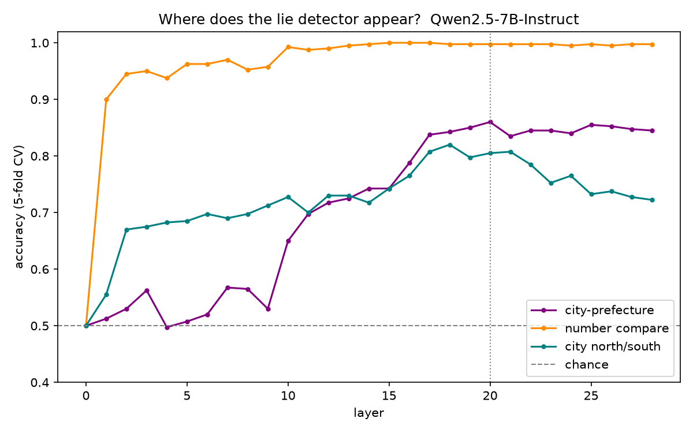
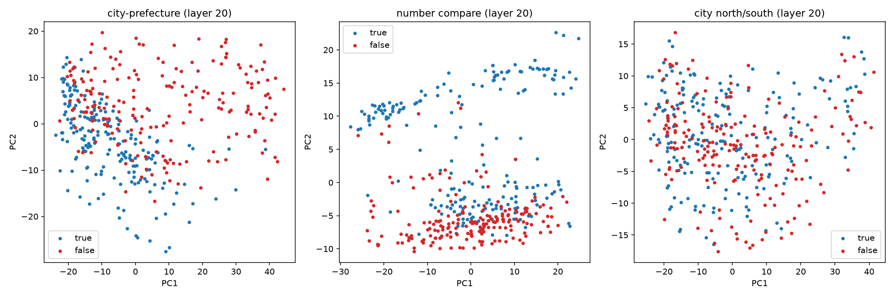
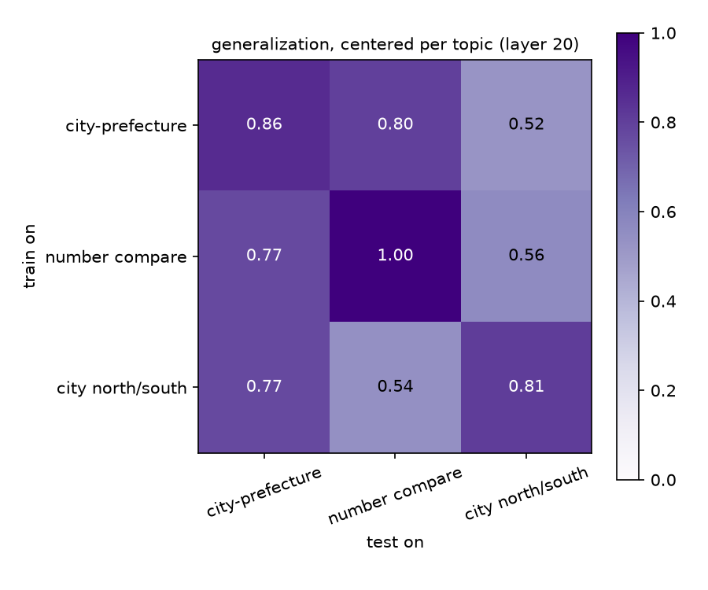
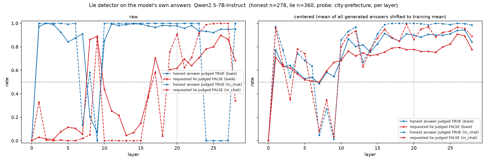
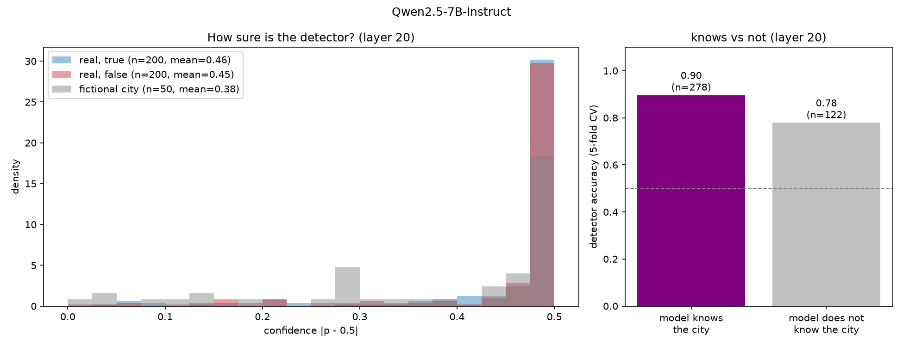
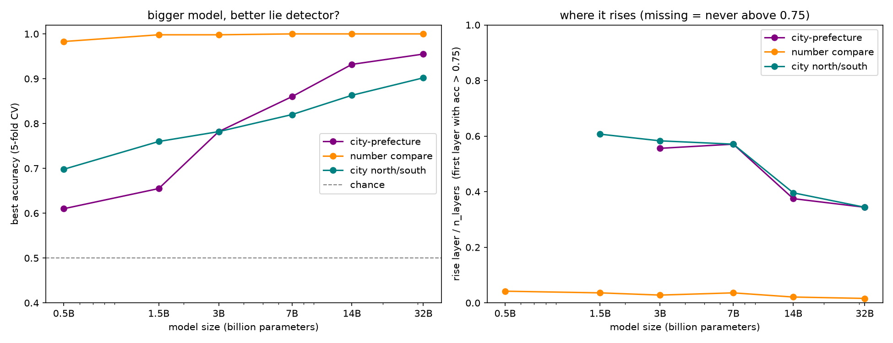

# 第5回 実験レポート：AIの中に嘘探知機はあるか（2026-10-26）

> 動画「AIに嘘をつかせたら、頭の中でバレていた【ずんだもん解説】」（シグマゼミ 第5回）で省いた細かい数字と手順を置いています。動画では層を「作業台」、ロジスティック回帰を「板を1枚立てる」と呼んでいます。学校のレポートや自由研究への引用・改造は自由です（出典として動画かこのページを書いてください）。

## 1. 問いと今日の式
- 問い：本当の文と嘘の文を読んだとき、AI の頭の中（各層のベクトル）は分かれているか。線1本で見分けられるか。
- 今日の式：ロジスティック回帰 p = σ(w·x + b)（x＝ある層の最後のトークンのベクトル）。補助：本当の平均と嘘の平均のなす角 cosθ。

## 2. 使ったもの
| 項目 | 内容 |
|---|---|
| モデル | Qwen/Qwen2.5-7B-Instruct（28層）。追加実験 c で 0.5B・1.5B・3B・7B・14B・32B（72B は今回時間切れ） |
| 精度・GPU | bf16、Google Colab A100（32B 以上は 4bit） |
| 実行日 | 2026-10-25 |
| コード | `truth_probe.py`、ノート `05_truth_probe.ipynb` |

## 3. データ
日本語の短い文を自動生成。各題材 本当200・嘘200＝400文（3題材で1,200文）。
| 題材 | 例（本当） | 嘘の作り方 |
|---|---|---|
| 都市と県 | 「鹿児島市は鹿児島県にある。」 | 別の県に差し替え |
| 数の大小 | 「84は37より大きい。」 | 大小を逆に |
| 方角 | 「札幌市は福岡市より北にある。」 | 南北を逆に（緯度差1度以上の組だけ） |
出典：都市の名前・座標・県は GeoNames（cities15000、CC BY 4.0）。

## 4. 手順
1. 各文をモデルに読ませ、各層の最後のトークンのベクトルを保存。
2. 層ごとにロジスティック回帰（scikit-learn、5分割交差検証）で本当／嘘を分け、正答率を出す。
3. 見張り：層0（埋め込みだけ）と、答えをシャッフルした場合が 50% 付近になることを確認。
4. 本当の平均ベクトルと嘘の平均ベクトルのなす角、題材をまたいだ「本当−嘘」の向きの角度。
5. 汎化：ある題材で学んだ線を別の題材に当てる（題材ごとに中心をそろえる）。

## 5. 結果（7B）
| 題材 | 最高正答率 | その層 | 層0 | シャッフル |
|---|---|---|---|---|
| 都市と県 | 86.0% | 20 | 50.0% | 50.0% |
| 数の大小 | 99.8% | 15 | 50.0% | 52.5% |
| 方角 | 82.0% | 18 | 50.0% | 52.5% |

- 都市と県は層9まで 50〜56%（偶然並み）、層10で 65%、層17で 84%、層20で 86%。**深い層で急に分かるようになる。**
- 数の大小は層1で既に 90%。数字の並びだけで分けられる易しい題材。
- 本当の平均と嘘の平均のなす角（層20）：都市と県 10.4°、数 6.7°、方角 2.9°。
- 題材をまたいだ「本当−嘘」の向きの角度：66〜81°（1本の共通の向きはない）。
- 汎化（層20、中心をそろえた版）：都市と県で学んだ線 → 数の大小 79.8%、→ 方角 52.0%。数で学んだ線 → 都市と県 77.0%。

**層ごとの正答率（嘘探知機はどこで立ち上がるか）**

**層20での散布図（主成分2つに落としたもの。青＝本当、赤＝嘘）**

**題材をまたいだ汎化（行＝学んだ題材、列＝当てた題材）**

## 6. 言えること・言えないこと
- 言える：本当の文と嘘の文で、深い層のベクトルは線1本で 8割以上分けられる。題材が違っても線は少し効く。
- 言えない：「AI が嘘を自覚している」「意図して嘘をつく」。分かるのは「文の真偽で中身の数字が違う」まで。
- 言えない：万能の嘘探知機がある（題材ごとに向きが 66〜81° 違う）。
- 注意：数の大小は浅い層で分かるので、「見抜けた＝賢い」ではない。
- 言える（追加実験）：AI 自身に嘘をつかせた文も、同じ線で 9 割見抜ける（会話の形のとき）。知っている都市の方が見抜きやすい。大きいモデルほど正確で、浅い位置で分かる。
- 言えない（追加実験）：「AI は嘘をついていると自覚している」。線が反応するのは文の真偽であって、意図ではない。

## 7. 追加実験（a・b・c）

### a. AI 自身に「嘘をついて」と頼んだ答えを探知機にかける
- 都市400件について、(i)「正直に一文で答えて：〇〇市は何県にありますか？」(ii)「〇〇市は何県にありますか？わざと間違った県を言って、一文で答えて。」の2通りで答えさせた（貪欲生成）。県名が取れた文だけ使用：正直 278 文、嘘 360 文（嘘を頼んだのに本当の県を言った 39 文は除外）。
- 本番の「都市と県」で学んだ線（層ごと）に、答えの文をかけた。会話の形のまま（in_chat）と、文だけ（bare）の2通り。
- **層20の結果：**

| 読ませ方 | 正直→「本当」 | 嘘→「嘘」 |
|---|---|---|
| 会話の形のまま（in_chat） | 99.6% | 90.8% |
| 会話の形・中心をそろえた版 | 100% | 86.1% |
| 文だけ（bare） | 97.8% | 61.7% |
| 文だけ・中心をそろえた版 | 89.9% | 77.8% |

動画では会話の形の2行の幅で「8〜9割」と言っています。文だけだと嘘の判定が大きく下がります（下の 7b も参照）。
- おまけ：嘘を頼まれたとき、モデルが選んだ「間違った県」は 399 件中 255 件（64%）が**鹿児島県**だった（次いで静岡県・茨城県）。嘘として使った 360 件に限ると 254 件（71%）。

### b. AI が知らない話では探知機は働くか
- 実在しない市名 50 個（例：倉福青市、金城岡市）＋実在の県で文を作り、層20の線にかけた。判定の確信度 |p−0.5| の平均は、実在の本当 0.46・実在の嘘 0.45 に対して**架空 0.38**（少し迷う）。架空の文は 64% が「本当」と判定された。
- モデルが都市の県を正しく答えられたか（知っているか）で分けると、**知っている都市 278 件では探知機の正答率 89.6%、知らない都市 122 件では 77.9%**（7B は都市の 69.5% を知っていた）。
- 読み方：知らないことでも文の形で少しは分かるが、知っていることの方がよく分かる。「知らない＝まったく働かない」ではない。

### c. モデルの大きさ比べ（Qwen2.5-Instruct、各題材 400 文）
| 大きさ | 層数 | 都市と県 | 方角 | 数の大小 | 都市と県が 75% を超える層（層数に対する割合） |
|---|---|---|---|---|---|
| 0.5B | 24 | 61.0% | 69.8% | 98.3% | 超えない |
| 1.5B | 28 | 65.5% | 76.0% | 99.8% | 超えない |
| 3B | 36 | 78.2% | 78.2% | 99.8% | 層20（0.56） |
| 7B | 28 | 86.0% | 82.0% | 100% | 層16（0.57） |
| 14B | 48 | 93.2% | 86.3% | 100% | 層18（0.38） |
| 32B | 64 | 95.5% | 90.2% | 100% | 層22（0.34） |
- **大きいほど嘘探知機は正確になり（61%→95.5%）、しかも相対的に浅い位置で立ち上がる**（層数の 57% → 34%）。数の大小はどの大きさでも層1〜2で分かる。
- 72B は 4bit でも時間内に終わらなかった（文だけ作って止まっている）。

## 7b. 動画で言わなかったこと
- 嘘を頼まれた 7B が鹿児島県ばかり答えた理由は分からない（学習データの偏りか、チャット形式の癖か）。
- a の bare（文だけ）版は層によって判定が大きく振れる（層8〜9 で逆転）。会話の形（in_chat）の方が安定した。
- b の架空の市名は漢字をランダムに組み合わせて GeoNames に無いことを確認したが、実在の小さな町と偶然同名の可能性は残る。
- 14B・32B は層数が多いので「層20」の比較は割合で見る。
- 結果を見てから選んだもの：一番よい層（20）と、会話の形という読ませ方。そのぶん数字は少し甘めです。本体の正答率は5分割交差検証の外側の文で測り、層0とシャッフルの見張りを付けています。
- 動画の主役アニメ（点が左右に分かれる図）は `05b_主役アニメの点.ipynb` で出した本物の点です（横軸＝交差検証の外側での判定値、縦軸＝その向きを除いた残りの第1主成分）。

## 8. 再現のしかた
ノート `05_truth_probe.ipynb` を Colab（A100 推奨）で上から実行。本番（7B）は数分、追加実験 a・b は 15〜20分、c は全サイズで 2〜3時間（72B は 80GB 向け）。

## 9. 出典
- Samuel Marks, Max Tegmark (2023). *The Geometry of Truth: Emergent Linear Structure in Large Language Model Representations of True/False Datasets.* COLM 2024. arXiv:2310.06824
- GeoNames（https://www.geonames.org/ 、CC BY 4.0）
- Qwen2.5-Instruct（Qwen チーム）：0.5B・1.5B・7B・14B・32B は Apache 2.0、3B は Qwen Research License（Hugging Face の各モデルページ、2026-10-26 確認）
- Wes Gurnee, Max Tegmark (2024). *Language Models Represent Space and Time.* ICLR 2024. arXiv:2310.02207（第4回）
