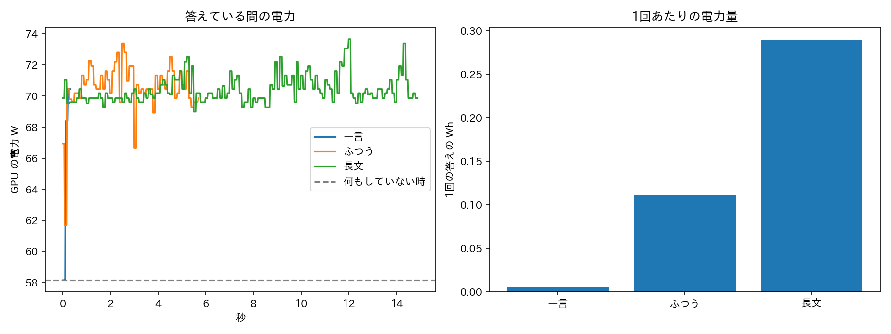
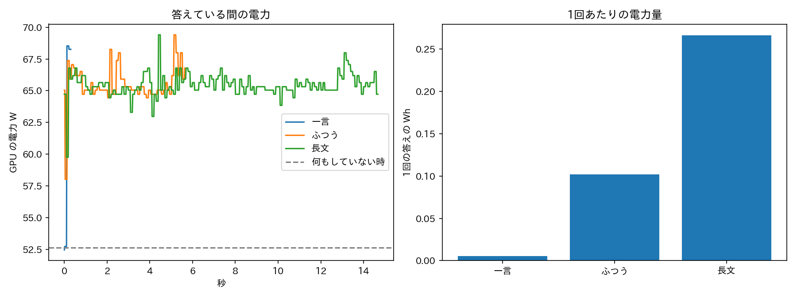
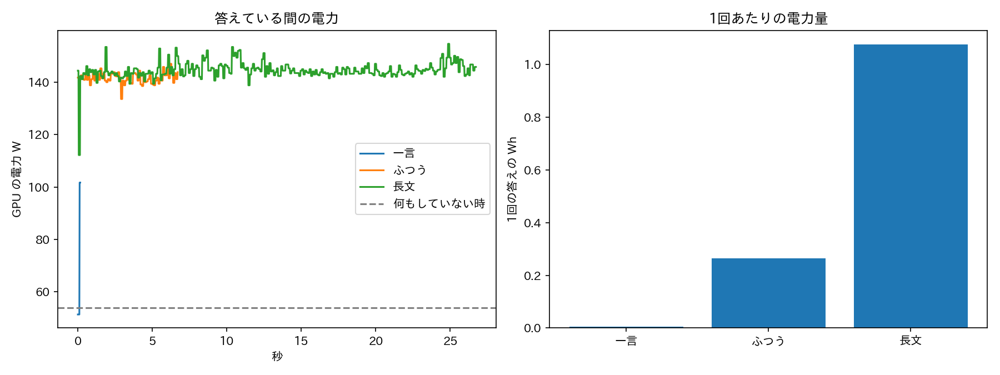

# 第8回 実験の記録：AIの電気は、どれくらいやばい？（2026-10-29〜30）

> 動画（シグマゼミ 第8回）で省いた細かい数字と手順を置いています。学校の課題や自由研究への引用・改造は自由です（出典として動画かこのページを書いてもらえるとうれしいです）。
> 数字は `results_a100`・`results_long`・`results_7b` の `out/summary.json` と `B_per_answer.csv`・`E_long_input.csv` から写しました（丸めたものは桁数を書いています）。

## 1. 問いと今日の式
- 問い：AIが1回答えるとき、電気はどれくらい使うのか。1回が小さいなら、なぜ「AIの電気」が問題になるのか。
- 今日の式：電力量 Wh ＝ 電力 W × 時間 h。答えている間の電力を0.02秒ごとに読み、（W × 秒）を全部足して3600で割る（台形則）。
- 「答えるための上乗せ分」＝ 測った Wh − 何もしていない時の W × 答えた秒数 ÷ 3600（`wh_extra`）。

## 2. 使ったもの
| 項目 | 内容 |
|---|---|
| モデル | Qwen/Qwen2.5-1.5B-Instruct（`results_a100`・`results_long`）、Qwen/Qwen2.5-7B-Instruct（`results_7b`） |
| 精度・GPU | fp16、借りた NVIDIA A100-SXM4-40GB（GPUの電力だけを測る） |
| 電力の読み方 | `pynvml` の `nvmlDeviceGetPowerUsage` を0.02秒ごと（別スレッド）。CPU・メモリ・冷却は入らない |
| 生成 | 乱数なし（`do_sample=False`）、最大トークン数は 一言16・ふつう200・長文800（まとめ16問は各120、資料は100） |
| 実行日・所要時間 | `results_a100` 2026-10-29 21:07〜21:10（210秒）／`results_long` 2026-10-30 03:15〜03:18（165秒）／`results_7b` 同 03:18〜03:22（245秒） |
| ライブラリの版 | 記録していない（ログに残っていない。借りた環境の当時の標準の PyTorch・transformers） |
| コード | `power.py`（実行例：`python3 power.py`、7Bは `python3 power.py --model Qwen/Qwen2.5-7B-Instruct --only A,B --out results_7b`） |

## 3. データ
質問は自作の短いもの（件数は各5回ずつ、まとめ16問のみ16問）。
| 記号 | 内容 | 件数 |
|---|---|---|
| B 一言 | 「日本の首都はどこ？一言で答えて。」 | 5回 |
| B ふつう | 「電気代を節約するコツを3つ教えて。」 | 5回 |
| B 長文 | 「AIと電気の関係について、くわしい説明文を書いて。」 | 5回 |
| C まとめ | 「11〜26の二乗はいくつ？理由もつけて答えて。」の16問 | 1回ずつ／まとめて |
| E 長い資料 | 電気に関する短い文を繰り返して作った資料＋「この資料を3行でまとめて。」 | 3段階×5回 |

## 4. 手順
- A 何もしていない時：10秒間、GPUの電力を読む（平均W）。
- B 一言・ふつう・長文：1回ずつ答えさせ、その間の W・秒・Wh・出たトークン数を記録。5回の平均を使う。最初に準備運動を1回して、測らない。
- C 16問を1問ずつ答えさせた合計と、16問を1回にまとめて（バッチで）答えさせた合計を比べる。
- D 計算：スマホの電池（13.8 Wh）、冷却の倍率 PUE 1.56、電気の単価 31円/kWh を掛け算で当てはめる（測った値ではない）。
- E 資料の長さを約100・1,000・5,000トークンに変えて、答えの長さは最大100トークンにそろえる。

## 5. 結果
### 5-1. 何もしていない時 A
| 実行 | 何もしていない時 |
|---|---|
| 1.5B（`results_a100`） | 58.1 W |
| 1.5B（`results_long`） | 52.6 W |
| 7B（`results_7b`） | 53.7 W |

### 5-2. 1回の答え B（5回の平均）
| 実行 | 種類 | 秒 | 平均 W | Wh | 上乗せ分 Wh | トークン |
|---|---|---|---|---|---|---|
| 1.5B 1回目 | 一言 | 0.31 | 68.9 | 0.00587 | 0.00092 | 8 |
| 〃 | ふつう | 5.66 | 70.6 | 0.1110 | 0.0196 | 168 |
| 〃 | 長文 | 14.82 | 70.4 | 0.2900 | 0.0506 | 439 |
| 1.5B 2回目 | 一言 | 0.29 | 64.9 | 0.00530 | 0.00100 | 8 |
| 〃 | ふつう | 5.61 | 65.6 | 0.1022 | 0.0202 | 168 |
| 〃 | 長文 | 14.61 | 65.6 | 0.2663 | 0.0526 | 439 |
| 7B | 一言 | 0.16 | 112.3 | 0.0050 | 0.0026 | 4 |
| 〃 | ふつう | 6.67 | 142.8 | 0.2645 | 0.1650 | 200 |
| 〃 | 長文 | 26.77 | 144.7 | 1.0763 | 0.6766 | 800 |

読み方：長いほど電気は増える（1.5Bで 一言→ふつう→長文 ≒ 1：19：49）。ただし小さいAIには大きすぎるGPUなので、答えている間（約70 W）と何もしていない時（約58 W）の差は小さく、ふつうの答えの電気のうち、答えるための上乗せ分は約18%だけ（0.0196 ÷ 0.1110）。

### 5-3. まとめて答えさせる C（1.5B、`results_a100` だけ）
| | 1問あたり Wh | 16問の合計の秒 |
|---|---|---|
| 1問ずつ | 0.0767 | 62.6 |
| まとめて16問 | 0.00529 | 4.21 |

1問あたり約14.5分の1。ただしGPUが空いている時間を含む実験で、データセンターの実際の混み具合とは違う。

### 5-4. スマホ・冷却・電気代 D（1.5B 1回目のふつうの答え 0.1110 Wh から）
| 値 | 計算 | 結果 |
|---|---|---|
| スマホの充電1回あたりの回数 | 13.8 ÷ 0.1110 | 約124回（2回目の 0.1022 Wh なら約135回） |
| 冷却込み（PUE 1.56） | 0.1110 × 1.56 | 0.173 Wh |
| 7B のふつうの答え | 13.8 ÷ 0.2645 | 約52回 |
| 電気代5,000円分 | 5000 ÷ 31 ≒ 161 kWh | スマホ充電 約1万2千回分／この小さなAIの答え 約145万回分（7Bなら約61万回分） |

### 5-5. 長い資料を貼る E（1.5B、`results_long`、答えは最大100トークン）
| 入力トークン | Wh（5回の平均） | 5回の範囲 |
|---|---|---|
| 86 | 0.0348 | 0.0346〜0.0351 |
| 989 | 0.0294 | 0.0283〜0.0309 |
| 4,988 | 0.0384 | 0.0334〜0.0408 |

左：答えている間のGPUの電力（点線は何もしていない時）。右：一言・ふつう・長文の1回あたりのWh。他の2回分は `
` にたたみます。

他の2回の図（results_long・results_7b）

## 6. 言えること・言えないこと
- 言えること：この小さなAI（1.5B）をA100で動かすとき、ふつうの答え1回は約0.10〜0.11 Wh。何もしていなくても約53〜58 W使う。まとめて答えさせると1問あたりは大きく減る。
- 言えないこと：
  - 測ったのはGPUだけ（冷却・CPU・ネットワークは入らない）。データセンター全体は PUE（平均1.56）を掛けた目安。
  - 小さなAI 1つ・A100 1枚での結果。ChatGPT などの大きなAI、画像・動画の生成は別（会社の発表や研究機関の推定を動画で引用）。
  - 2030年の世界のデータセンターの電気（約945 TWh）は IEA の見込み。確定ではない。
  - 長い資料の実験は、同じ文を繰り返した人工の資料で、答えを最大100トークンにそろえた粗い比べ。大きなAIで同じになるとは限らない。

## 7. 動画で言わなかったこと
- 動画の冒頭の「ありがとうなのだ！」の画面で出した「一言の返事 約0.006 Wh」は、実際に「ありがとう」を送って測った値ではない。「日本の首都はどこ？一言で答えて。」への一言の返事（8トークン、5回の平均 0.00587 Wh）の再現で、その値を当てはめた。ほかの短い返事でも同じ桁になるはずだが、測り直してはいない。
- ふつうの答えは測るたびに少しずれる：1回目 0.111 Wh、2回目 0.102 Wh（どちらも5回の平均）。動画では 0.11 を使っている。同じ回の5回の中のばらつきは小さい（1回目 0.1104〜0.1118）。
- 動画の「語」は、実際は AI が数えるトークンの数（一言8、ふつう168、長文439）。資料の「約90語・1,000語・5,000語」も、実際は86・989・4,988トークン。
- 長い資料の実験は、989トークンのほうが86トークンより少なかった（0.0294 < 0.0348 Wh）。入力が長いほど増える、という形にはなっていない。5回の範囲が重なるので、差は小さい。
- 7B の「一言」は、答えが「東京です。」（4トークン）と短くなり、1.5B の「日本国の首都は東京です。」（8トークン）と同じ比べ方にならない。5回の範囲も 0.0030〜0.0064 Wh と広い。
- 7B のふつうの答えは 1.5B の約2.5倍（0.2645 ÷ 0.1110 ≒ 2.4、2回目と比べると 2.6）。モデルが大きいほど、同じ答えの長さでも電気は増える。
- 上乗せ分で見ると、7B は 1.5B の約8倍（0.165 ÷ 0.0196）。小さいAIは大きなGPUを持て余しているので、待機の電気に隠れて差が小さく見える。
- まとめ（C）は `results_a100` の1回だけ。`results_long` と `results_7b` では回していない。
- 電気代5,000円（約161 kWh）の換算は、動画では「スマホの充電 約1万2千回分」にした。この小さなAIの答えの回数（約145万回）は、桁が大きすぎるので動画では言っていない。
- Google の発表（Gemini の質問1回 中央値 0.24 Wh）は、動画では「1年で33分の1」だけ使った。0.24 Wh との直接の比べは、測り方が違うので言っていない。
- 動画のドライヤー（約1,200 W）は一般的な目安で、今回測ったものではない。

## 8. 再現のしかた
- `power.py` を GPU を借りられる環境（A100 など）で実行する。電力の読み取りに NVIDIA の GPU が必要（CPUだけだと電力は空欄になる）。
- 所要時間：1.5B で約3〜4分（`summary.json` の記録では210秒と165秒）、7B（A と B だけ）は約4分（245秒）。
- 注意：A の「何もしていない時」は実行ごとに変わった（1回目 58 W、半日後の2回目 53 W）。結果は GPU・時間帯で変わるので、数字は目安として読む。
- 出力：`out/summary.json`（主な数字）、`B_per_answer.csv`（1回ごと）、`E_long_input.csv`（資料の長さ別）、`power.png`。

## 9. 出典
- IEA "Energy and AI"（2025年4月）：世界のデータセンターの電気 2024年 約415 TWh、2030年 約945 TWh（見込み）。2024年の数字は報道経由で確認、IEA 本文との照合はこれから。
- Google Cloud ブログ（2025年8月）"Measuring the environmental impact of AI inference"：Gemini の文章の質問1回 中央値 0.24 Wh。
- MIT Technology Review（2025年5月20日）"We did the math on AI's energy footprint"：5秒の動画 約340万J（約940 Wh）。
- Epoch AI（2025年2月）：入力が長いほど電気が増える見積もり。
- OpenAI の CEO が2025年4月にSNSで返した冗談まじりの返事 "Tens of millions of dollars well spent"。報道による。元の投稿は未確認。
- PJM の容量オークション（2025年12月）、ノースカロライナ州（2026年10月27日）、スリーマイル島1号機の再稼働（2024年9月契約）、Google Project Suncatcher（2025年11月・2026年10月）：概要欄の出典の欄を参照。
- Uptime Institute (2024) の PUE 平均 1.56。電気の単価 31円/kWh は全国家庭電気製品公正取引協議会の目安。iPhone 16 の電池 約13.8 Wh（3,561mAh × 3.87V の計算）。
- Qwen2.5（Alibaba、Apache 2.0）。
